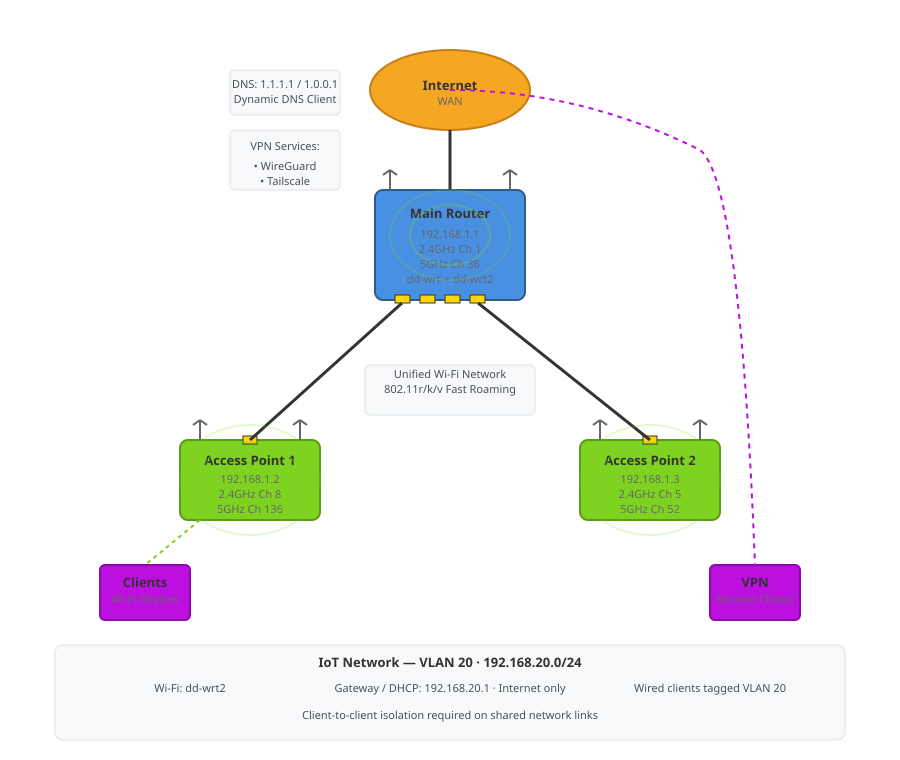

# Ansible OpenWrt

This Ansible playbook provisions an OpenWrt network from factory defaults. It automatically configures:

- Automatic WAN bandwidth management ([CAKE Autorate](https://github.com/lynxthecat/cake-autorate))
- Wi‑Fi with fast client roaming across all OpenWrt devices
- WireGuard server to access LAN devices with easy QR-code client setup
- Tailscale client with subnet routing
- Dynamic DNS via [no-ip.com](https://www.noip.com/) and [FreeDNS (Afraid)](https://freedns.afraid.org/)
- Hostnames
- Timezones
- WAN DNS servers
- Prometheus Exporters

Tested on OpenWrt 25.12 and 24.10.

## Network Diagram



## IoT network

The playbook adds a separate IoT network to the router and every configured access point:

- The IoT SSID is configured by `vault_iot_wifi_ssid`; the existing LAN SSID remains separate.
- VLAN: `20`
- IPv4 subnet and gateway: `192.168.20.0/24`, `192.168.20.1`
- DHCP, DNS, and routing are provided by the main OpenWrt router.
- IoT clients can reach the internet, but the router firewall does not forward IoT traffic to the LAN.
- The IoT SSID name and password are configured through `vault_iot_wifi_ssid` and `vault_iot_wifi_password` in `group_vars/all/vault.yml`. Add both variables to your encrypted vault before running the playbook; example values are in `vault_example.yml`.
- It shares the existing Wi-Fi radio settings, country, timezone, and 802.11r/k/v roaming configuration. Its SSID, network, and password remain separate.
- At the end of every playbook run, the configured AP radios and both LAN and IoT SSID interfaces are explicitly enabled and wireless is reloaded. This briefly interrupts Wi-Fi while each AP applies the enabled state.

The role follows the [OpenWrt VLAN/switch configuration guide](https://openwrt.org/docs/guide-user/network/vlan/switch_configuration). On DSA devices, it configures VLAN 1 as the existing untagged LAN, moves the LAN interface to `br-lan.1`, and configures VLAN 20 as tagged on the verified ports listed in `iot_dsa_trunk_ports`, with the local bridge port enabled. Set `iot_vlan_mode: dsa`, list all existing LAN ports in `iot_dsa_native_ports`, and list only physically verified IoT trunk/uplink ports in `iot_dsa_trunk_ports` in `hosts.yml`. On legacy swconfig devices, the role configures VLAN 20 on the switch CPU port and verified physical trunk ports; specify the switch, CPU device/port, unique switch VLAN index, and uplink port list. VLAN 20 avoids the TL-WDR4300's existing use of switch VLAN 2 for WAN. The IoT network tasks fail before changing any host if its mode or required port mappings are missing. Verify that VLAN 20 and `192.168.20.0/24` are otherwise unused.

Every link from the router through access points and switches must carry VLAN 20 tagged, while preserving the existing LAN's untagged/native traffic. Do not configure VLAN 20 on the WAN link.

### Strict client isolation

The IoT network is intended to keep each client from reaching any other IoT client. The playbook enables Wi-Fi client isolation and installs persistent nftables bridge rules on all OpenWrt devices to block peer IPv4/ARP traffic on the IoT subnet and IPv6 forwarding on VLAN 20, while allowing traffic to and from the gateway. This bridge filtering is needed because router firewall rules alone do not see traffic switched directly between clients on the same VLAN. The router allows IoT DHCP/DNS and IoT-to-WAN forwarding only, and blocks IoT clients from its management interface; manage OpenWrt through the existing LAN instead.

Wi-Fi client isolation covers peers on the same access point; the bridge rules cover clients connected through different access points.

After applying the playbook, verify from clients on different APs that:

1. They obtain an address in `192.168.20.0/24`, with gateway `192.168.20.1`.
2. They can resolve DNS and reach the internet.
3. They cannot reach another IoT Wi-Fi client.
4. They cannot reach a host on the existing LAN.

## Install Ansible and run the playbook

On Windows, use WSL (Ubuntu/Debian) to run Ansible. Quick steps in WSL:

```bash
sudo apt update
sudo apt install -y python3 python3-pip python3-venv
```

Clone this repository and change into its directory.

### Setup Python Virtual Environment

Create and activate a Python virtual environment:

On Windows (WSL), use:
```bash
python3 -m venv venv
source venv/bin/activate
```

Install Ansible and required dependencies in the virtual environment:

```bash
pip install --upgrade pip
pip install -r requirements.txt
ansible-galaxy collection install -r requirements.yml -p collections
```

### Configure Vault

Create a vault password file containing only your password on the first line:

```bash
nano ~/.vaultfile
```

Copy `vault_example.yml` to `group_vars/all/vault.yml` and update the variables:

```bash
cp vault_example.yml group_vars/all/vault.yml

# Encrypt a vault file (first time)
ansible-vault encrypt group_vars/all/vault.yml

# Edit an encrypted vault file
ansible-vault edit group_vars/all/vault.yml

# View vault contents without editing
ansible-vault view group_vars/all/vault.yml
```

### Configure Hosts

Edit `hosts.yml` for your setup. An example is provided. Change the wifi device paths to suit your device using `cat /etc/config/wireless` otherwise might need to factory reset device to find the correct device paths.

### Run the Playbook

Make sure your virtual environment is activated, then run the playbook:

```bash
# Activate the virtual environment (if not already active)
source venv/bin/activate

# Run the playbook
export ANSIBLE_CONFIG=./ansible.cfg
ansible-playbook site.yml
```

To deactivate the virtual environment when finished:

```bash
deactivate
```

## Access Points Setup

By default, OpenWrt devices share the same factory default settings. This is fine for the main router but not ideal for access points. Before connecting access points to your network and running this Ansible playbook, update their basic settings via LuCI.

1. Preparation

- Connect the OpenWrt access point only to your computer via an Ethernet cable.
- Do not connect it to your main router yet to avoid IP conflicts.

2. Disable the firewall and DHCP; set a static LAN IP

- Log in to LuCI (default 192.168.1.1).
- Navigate to Network → Interfaces and click Edit on the LAN interface.
- Under General Setup:
	- Set the IPv4 address to an unused IP in your main router's subnet (e.g., if your main router is 192.168.1.1, use 192.168.1.2).
	- Set the IPv4 gateway to your main router's IP (e.g., 192.168.1.1).
	- Set "Use custom DNS servers" to your main router's IP.
- In DHCP Server → General Setup, check "Ignore interface" to disable DHCP on this device.
- Under the IPv6 Settings tab, disable RA-Service and disable DHCPv6.

Save and apply the changes, then reconnect the device to your main network.

## CAKE Autorate note

A custom CAKE autorate config file can be placed at `/custom_files/config.primary.sh` which are git ignored. Use Unix line endings.

## Tailscale

Tailscale is disabled by default. To enable it, set `tailscale_enabled: true` in your inventory variables.

This Ansible playbook cannot fully automate the security approvals required by the Tailscale platform itself and some manual steps are required:
- Approve Subnet Routes: Go to the Tailscale Admin Console, click the three-dot menu (...) 
  for your OpenWrt router, select Edit route settings, and check the box for your subnet.
- Client Configuration: On your remote device (phone/laptop), ensure the Tailscale app setting 
  "Use Tailscale Subnets" is toggled ON to reach your LAN devices.

## Wireguard tips

- Setup a Dynamic DNS service
- Change port from the default 51820 to a different high a random port. A different port can be defined in the vault.
- To add the Wireguard client to your device with a QR code:
	- On the main router (192.168.1.1), navigate to Network → Interfaces and click Edit on the Wireguard interface.
	- With the Wireguard interface settings open, navigate to Peers tab, click Edit for client1
	- At the bottom, click Configuration Export
	- Set the Connection Enpoint to your Dynamic DNS service
	- In the Wireguard app on your device, press add and scan QR code